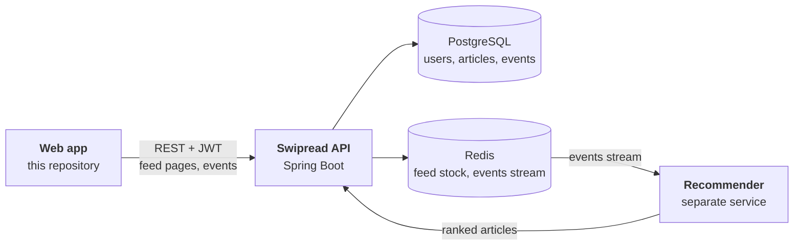
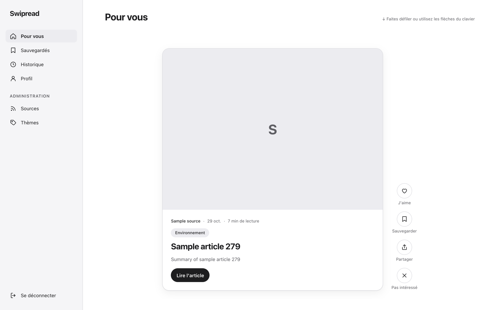
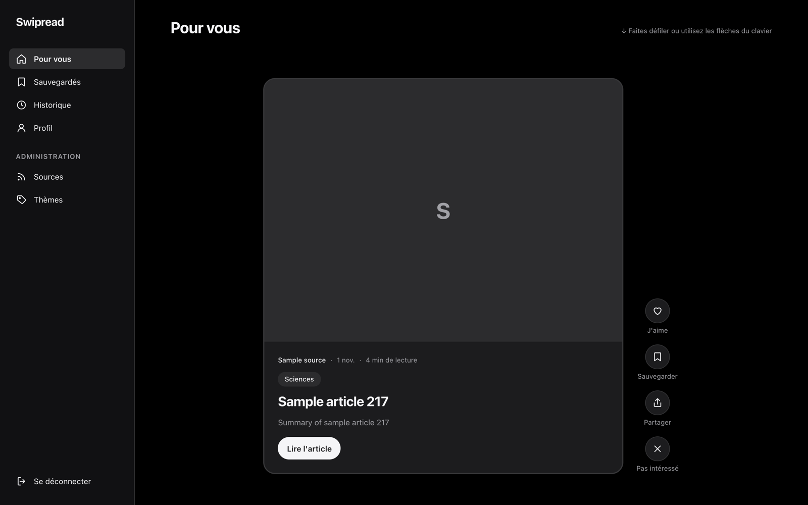
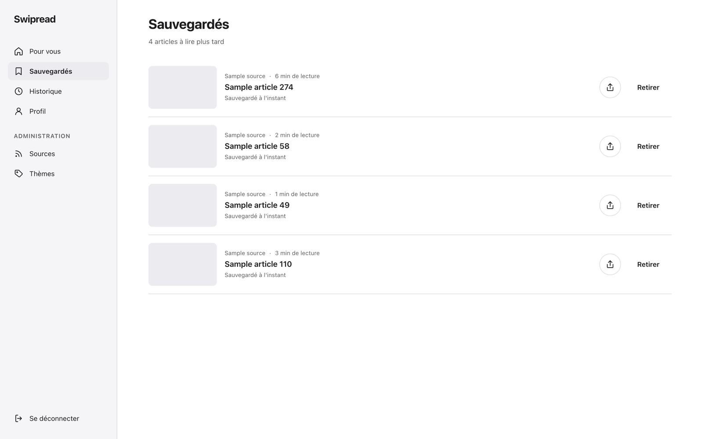
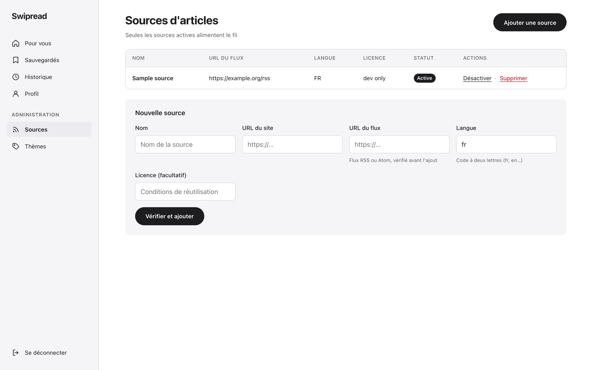

# Swipread · web

**Read the news one card at a time.** Swipread is a feed of recommended articles you scroll like short videos: one article per screen, and every scroll, read and like teaches the recommender what you want next.

This repository is the web app: React 19 + TypeScript, desktop first and fully responsive, light and dark themes, French UI.


## Contents

- [How Swipread fits together](#how-swipread-fits-together)
- [Screenshots](#screenshots)
- [Features](#features)
- [How it works](#how-it-works)
- [Getting started](#getting-started)
- [Scripts](#scripts)
- [Project structure](#project-structure)
- [Testing](#testing)
- [Browser support](#browser-support)
- [Project status](#project-status)
- [Documentation](#documentation)
- [License](#license)

## How Swipread fits together



The web app never ranks articles itself. It shows the pages the API serves from a per-reader stock of recommended articles, and reports what the reader does with each card. The API stores these events and streams them to the recommendation service, which refills the stock. The backend lives in [**Swipread/api**](https://github.com/Swipread/api).

## Screenshots

| Feed | Dark theme | Mobile |
| --- | --- | --- |
|  |  |  |

| Saved articles | Administration |
| --- | --- |
|  |  |

*Articles, sources and photos in these screenshots are fictional demo data (photos from [Lorem Picsum](https://picsum.photos)).*

## Features

| For readers | For administrators | Under the hood |
| --- | --- | --- |
| Sign up, pick at least three topics | Add RSS/Atom sources (the API checks the feed first) | Typed API client generated from OpenAPI |
| Full-screen feed: scroll, swipe or ↑/↓ | Activate, deactivate or delete sources | Batched event tracking with a `keepalive` final flush |
| Like, save, share, « not interested » | Create and rename topics, with article and reader counts | 15-minute access token renewed silently, across tabs |
| Saved list and reading history | Admin-only routes and navigation | Light and dark themes, reduced motion, keyboard and screen reader support |
| Edit name and topics, delete the account | | Every screen handles loading, errors with retry, and empty states |

## How it works

**One card per screen.** The feed is a CSS `scroll-snap` container. An `IntersectionObserver` tracks the card on screen, the next page is fetched when three cards remain, and the position is restored when you come back. The arrow keys move between cards, with smooth scrolling turned off for readers who prefer reduced motion. → [Feed](docs/features/feed.md)

**Every interaction is a signal.** Impressions, time spent on each card (excluding hidden-tab time), opens, reading time on the source's site, likes, saves, shares and hides are queued, sent in batches of up to 100 every 5 seconds, retried on failure, and flushed with `fetch(…, { keepalive: true })` when the tab closes. → [Tracking](docs/features/tracking.md)

**Sessions that survive.** The access token lasts 15 minutes; the refresh token lives in an HttpOnly cookie that JavaScript never sees. The client renews before expiry and after a 401, replays the failed request, and shares one renewal between concurrent requests and, through the Web Locks API, between tabs. → [Backend integration](docs/backend-integration.md#authentication)

**A typed contract with the backend.** Types are generated from the API's OpenAPI spec; an API change shows up as a compile error. Server errors are mapped to French messages, field by field. → [Decision records](docs/decisions.md)

**Accessible by default.** Visible focus, labelled icon buttons, `aria-pressed` toggles, live regions for counters and toasts, native `<dialog>` confirmations, colours chosen for AA contrast in both themes. Tests query the UI by role and label, so a missing label fails a test. → [Contributing](docs/contributing.md#accessibility-checklist)

## Getting started

### Prerequisites

| Tool | Version | For |
| --- | --- | --- |
| Node.js + npm | 20.19+ or 22.12+ | This app |
| Java | 25 | The Swipread API |
| Docker | recent | PostgreSQL and Redis, started by the API |

### 1. Start the API

With Docker running:

```bash
git clone https://github.com/Swipread/api.git
cd api
./mvnw spring-boot:run -Dspring-boot.run.profiles=dev
```

The `dev` profile starts PostgreSQL and Redis, creates the schema, seeds topics, sample articles and an admin account, and allows the web app's origin. The API listens on <http://localhost:8080>.

### 2. Start the web app

```bash
git clone https://github.com/Swipread/web.git
cd web
npm install
cp .env.example .env.local
npm run dev
```

Open <http://localhost:5173>. Keep this port: it is the origin the API accepts in development.

### 3. Log in

Create an account, or use the seeded admin: `admin@swipread.dev` / `password123`.

### Configuration

| Variable | Default | Purpose |
| --- | --- | --- |
| `VITE_API_BASE_URL` | `http://localhost:8080` | API base URL, inlined at build time |

More in [Getting started](docs/getting-started.md), including troubleshooting.

## Scripts

| Command | What it does |
| --- | --- |
| `npm run dev` | Dev server on port 5173 |
| `npm test` | Run the test suite (`npm run test:watch` to watch) |
| `npm run lint` | ESLint |
| `npm run build` | Type-check and build into `dist/` |
| `npm run preview` | Serve the production build |
| `npm run gen:api` | Regenerate API types from the OpenAPI spec (`OPENAPI_URL` to change the URL) |

## Project structure

```text
src/
├── api/        typed client, generated types, error mapping, token renewal
├── app/        routes, guards, layout and navigation
├── features/   one folder per feature: auth, onboarding, feed, tracking,
│               share, saved, history, profile, admin
├── lib/        session storage, ids, French formatting, media queries
├── ui/         shared components, icons and design tokens
└── test/       msw server and handlers, fixtures, render helpers
```

Code is organised by feature: each folder holds its pages, components, hooks, validation schemas and tests. → [Architecture](docs/architecture.md)

## Testing

```bash
npm test
```

160+ tests with Vitest, Testing Library and Mock Service Worker run in a few seconds, with no API needed: every request is answered by typed handlers. Tests drive the UI like a user, through roles and accessible names. → [Testing](docs/testing.md)

## Browser support

Current versions of Chrome, Edge, Firefox and Safari, on desktop and mobile. The app relies on CSS scroll snapping, `IntersectionObserver` and the native `<dialog>` element; the Web Share API and Web Locks are used when available, with fallbacks (clipboard, in-tab renewal).

## Project status

The reader and admin user stories are implemented and verified against the API: onboarding, feed, reactions, sharing, saved list, history, profile and account deletion, source and topic administration, token renewal.

Known limitations:

- French UI only, without an i18n framework.
- No offline mode or installable PWA.
- The recommendation reason (`similar`, `explore`…) is tracked but not displayed.

## Documentation

| | |
| --- | --- |
| **Guides** | [Getting started](docs/getting-started.md) · [Architecture](docs/architecture.md) · [Backend integration](docs/backend-integration.md) · [Flows](docs/flows.md) · [Testing](docs/testing.md) · [Contributing](docs/contributing.md) · [Deployment](docs/deployment.md) · [Decision records](docs/decisions.md) · [FAQ](docs/faq.md) · [Glossary](docs/glossary.md) |
| **Features** | [Authentication](docs/features/auth.md) · [Onboarding](docs/features/onboarding.md) · [Feed](docs/features/feed.md) · [Tracking](docs/features/tracking.md) · [Sharing](docs/features/sharing.md) · [Saved](docs/features/saved.md) · [History](docs/features/history.md) · [Profile](docs/features/profile.md) · [Administration](docs/features/admin.md) |
| **Reference** | [UI components](docs/reference/ui-components.md) · [Hooks and cache](docs/reference/hooks-and-cache.md) · [Design tokens](docs/reference/design-tokens.md) · [Messages](docs/reference/messages.md) · [Endpoints](docs/reference/endpoints.md) |

Start from the [documentation index](docs/README.md).

## License

All rights reserved. The source is published for reference only; no license is granted to use, copy, modify or distribute it without the author's written permission.

© William Machecourt
