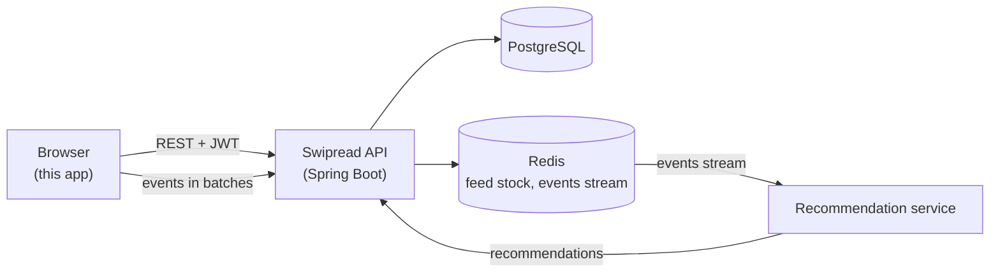

# Architecture

## Overview

The frontend only talks to the API. It never computes recommendations: it shows the pages the API returns and reports what the reader does with them. See [Backend integration](backend-integration.md) for the details of each exchange.

## Code organisation

The code is organised **by feature**, not by layer. A feature folder holds its pages, components, hooks, Zod schemas and tests side by side.

| Folder | Content |
| --- | --- |
| `src/api/` | `client.ts` (typed `openapi-fetch` client), `schema.d.ts` (generated, never edited), `types.ts` (`Schema<'Name'>` shorthand), `problem.ts` (errors), `refresh.ts` (token renewal), `queryClient.ts` |
| `src/app/` | `routes.tsx`, `guards.tsx`, `AppLayout`, `Sidebar`, not found page, 401 handler |
| `src/features/auth/` | Login and sign-up pages, session hooks (`useSession`, `useMe`, `useLogin`, `useLogout`…) |
| `src/features/onboarding/` | Topic picker (reused by the profile), topic hooks |
| `src/features/feed/` | Feed page, article card and actions, infinite query, active card detection, keyboard navigation, position memory |
| `src/features/tracking/` | Event queue and the feed tracking hook |
| `src/features/share/` | Web Share API with clipboard fallback |
| `src/features/saved/`, `history/`, `profile/` | The corresponding pages and hooks |
| `src/features/admin/` | Sources and topics administration, admin layout |
| `src/lib/` | Framework-free helpers: session storage, ids, French formatting, media queries |
| `src/ui/` | Shared components (`Button`, `IconButton`, `TextField`, `Chip`, `ConfirmDialog`, `Toast`, state components…), icons, design tokens |
| `src/test/` | msw server and default handlers, fixtures, render helpers, jsdom polyfills |

A feature may import from `api/`, `lib/`, `ui/` and, sparingly, from another feature's hooks (the profile reuses the onboarding topic picker). Shared components never import from features.

## Routing and guards

Routes use React Router in data mode (`createBrowserRouter`). Paths are in French, like the UI.

| Path | Page | Guards |
| --- | --- | --- |
| `/connexion`, `/inscription` | Login, sign-up | `RedirectIfAuthenticated` |
| `/centres-interet` | Topic picker | `RequireAuth` |
| `/` | Feed (« Pour vous ») | `RequireAuth`, `RequireOnboarding` |
| `/sauvegardes`, `/historique`, `/profil` | Saved, history, profile | `RequireAuth`, `RequireOnboarding` |
| `/admin/sources`, `/admin/themes` | Administration | … and `RequireAdmin` |

- `RequireAuth` redirects to `/connexion?redirect=…` when there is no session; the login page sends the reader back afterwards.
- `RequireOnboarding` loads the profile (`GET /v1/me`) and sends readers without topics to the picker.
- `RequireAdmin` reads `role` from the profile. It only hides screens: the API enforces the role on `/v1/admin/**`.
- Any authenticated request that ends in 401 (after a failed token renewal) clears the session and goes to the login page, remembering the current page.

## Server state

All API calls go through hooks built on TanStack Query, never through `fetch` in components.

- Queries use the default client (`retry: 1`, no refetch on window focus). The profile is cached for five minutes; mutations update it in place.
- Mutations update the cache directly when the response holds the new state (for example a renamed topic), or invalidate the queries that depend on it (creating a topic invalidates the reader's topic list).
- The feed is an infinite query with `staleTime: Infinity`: each `GET /v1/feed` consumes articles from the reader's stock, so refetching would replace the pages already read. Changing topics removes the feed from the cache instead.

## The feed

- **Layout.** One card per screen with CSS `scroll-snap`. The current card is found with an `IntersectionObserver` (`useActiveIndex`).
- **Navigation.** Mouse wheel, touch, and ↑/↓/Page Up/Page Down (`useFeedKeyboard`). Repeated key presses keep moving forward while a smooth scroll is in flight; smooth scrolling is turned off with `prefers-reduced-motion`.
- **Prefetch.** The next page is requested when three cards or fewer remain below the current one.
- **Position memory.** The current article id is kept in `sessionStorage`, so the feed reopens on it after reading an article or visiting another page.
- **Actions.** Like, save, share and « Pas intéressé » update the card in the cache immediately and record an event; « Pas intéressé » removes the card and moves the focus to the next one.

## Design system

- **Tokens.** Colours, spacing, radii, typography and durations are CSS custom properties in `src/ui/tokens.css`. Components only use these variables. Dark mode redefines the colour tokens under `prefers-color-scheme: dark`; reduced motion sets the durations to zero.
- **Styling.** One CSS Module per component (`Component.module.css`). The look is deliberately sober: system font, lots of space, few colours, discreet animations.
- **Layout.** A fixed sidebar on desktop becomes a bottom tab bar under 768 px. On mobile the two admin pages share one « Admin » tab and switch with segmented tabs.
- **States.** Every screen handles loading (`LoadingState`), errors with a « Réessayer » button (`ErrorState`) and empty lists (`EmptyState`).
- **Accessibility.** Icon buttons require an `aria-label`, toggles use `aria-pressed`, focus is always visible, contrast meets WCAG AA in both themes, dialogs use the native `<dialog>` (focus trap, Escape) with the initial focus on « Annuler ».

## Language

The UI is in French; code, comments, tests and this documentation are in English. Dates, relative times (« Il y a 2 h ») and numbers (« 1 284 ») are formatted with `Intl` in `src/lib/format.ts`.
