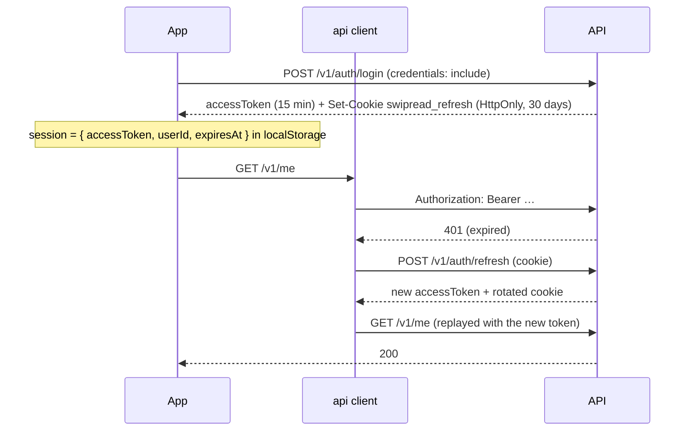

# Backend integration

The API's OpenAPI spec is the source of truth for endpoints and payloads. Its full reference lives in the API repository: [`docs/api.md`](https://github.com/Swipread/api/blob/main/docs/api.md).

## Generated types

`npm run gen:api` turns the spec into `src/api/schema.d.ts`. Never write a DTO by hand and never edit that file: use the generated types through the `Schema` shorthand.

```ts
import type { Schema } from '../api/types'

type Card = Schema<'FeedItem'>
```

## API client

`src/api/client.ts` exports `api`, an [`openapi-fetch`](https://openapi-ts.dev/openapi-fetch/) client typed with the generated paths, and `unwrap`, which returns the data or throws an `ApiError`.

```ts
const topics = await unwrap(api.GET('/v1/topics', { signal }))
```

The client:

- adds `Authorization: Bearer <access token>` to every request except `/v1/auth/*`;
- sends cookies (`credentials: 'include'`) to `/v1/auth/*` only, for the refresh token;
- renews the access token when needed (see below);
- on a final 401, clears the session and calls the unauthorized handler, which goes to the login page.

## Errors

The API answers errors as RFC 9457 `ProblemDetail` (`application/problem+json`). Its `detail` is in English and is never shown as is. `src/api/problem.ts` turns any failure into an `ApiError`:

| Field | Content |
| --- | --- |
| `status` | HTTP status, or `0` when the server could not be reached |
| `message` | A French message chosen from the status (« Votre session a expiré », « Le service est momentanément indisponible »…) |
| `fieldErrors` | For validation errors: a French message per field, chosen from `errors[].code` (`NotBlank`, `Size`, `Email`, `Pattern`) |
| `problem` | The raw `ProblemDetail`, for the few cases that need its `detail` |

Forms map `fieldErrors` onto their fields with React Hook Form's `setError`. Screens show `getErrorMessage(error)` with a « Réessayer » button. A few endpoint-specific details are translated where they are documented, for example the feed check messages of `POST /v1/admin/sources` (`src/features/admin/feedProblem.ts`).

## Authentication



- **Session.** `src/lib/session.ts` stores the access token, the user id and the expiry time in `localStorage`, and keeps tabs in sync through the `storage` event. The session outlives its access token: only a refused renewal or a logout ends it.
- **Refresh token.** It lives in the `swipread_refresh` cookie (HttpOnly, `SameSite=Strict`, path `/v1/auth`). JavaScript never sees it; the browser sends it to `/v1/auth/refresh` and `/v1/auth/logout`.
- **Renewal** (`src/api/refresh.ts`):
  - on a 401 from any other endpoint, the client renews once and replays the request, body included;
  - before sending, it renews if the token expires within 60 seconds, and a timer checks every 30 seconds while the tab is visible, so the last events sent when the tab closes carry a valid token;
  - only one renewal runs at a time: concurrent requests share it, and other tabs wait on a Web Lock and reuse the token the first tab obtained (each renewal rotates the cookie);
  - a network failure during renewal surfaces as a network error and keeps the session; a 401 from `/v1/auth/refresh` ends it.
- **Logout** sends pending events, calls `POST /v1/auth/logout` (revokes the refresh token, clears the cookie) and clears the session and the query cache.

## Event tracking

Interactions are reported to `POST /v1/events`, always through `tracker` (`src/features/tracking/tracker.ts`), never by calling the endpoint directly.

| Event | When | Payload |
| --- | --- | --- |
| `impression` | A card becomes the current one (once per card) | — |
| `view` | The card stops being current | `dwellMs`, without the time the tab was hidden |
| `open` | « Lire l'article » opens the source's page in a new tab | — |
| `read` | The reader comes back after an `open` | `readMs` (time away). `scrollDepth` is not measurable on a third-party site and is not sent |
| `like` / `unlike`, `save` / `unsave` | Reaction toggled, in the feed or in the saved list | — |
| `share` | Article shared | `channel` |
| `hide` | « Pas intéressé » | — |

Each event carries a client-generated `eventId` (`e_<uuid>`), the `articleId`, the `requestId` and `position` received with the card, and `occurredAt`. Batches carry a per-tab `sessionId`.

The queue (`eventQueue.ts`):

- sends every 5 seconds, as soon as 20 events are queued, when the tab is hidden, and on logout;
- splits into batches of at most 100 events, keeps at most 500 when the server is unreachable, and retries on network errors, 429 and 5xx (the API deduplicates on `eventId`);
- on `pagehide`, closes the current `view` and sends everything with `fetch(…, { keepalive: true })`. `navigator.sendBeacon` is not used because it cannot send the `Authorization` header.

`GET /v1/feed` also receives `X-Session-Id` and `X-Device` (`mobile` or `desktop`), which the API forwards to the recommendation service.
