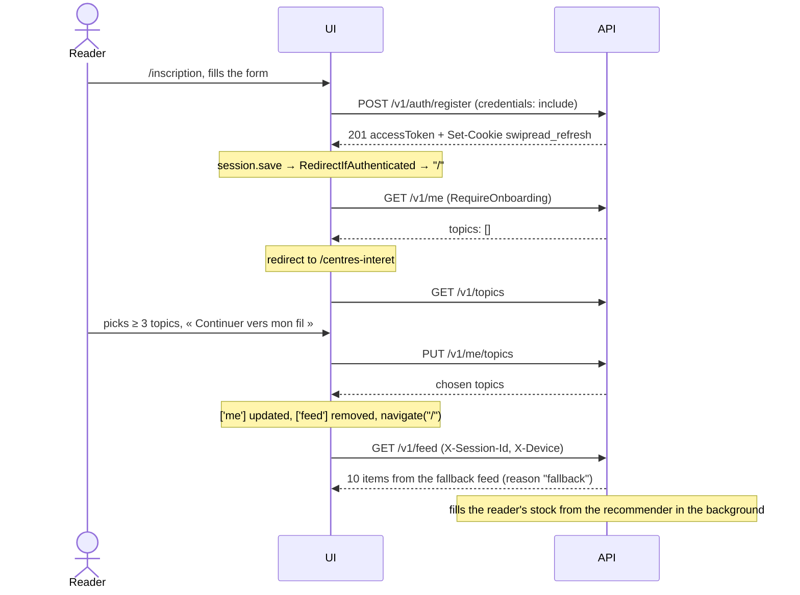
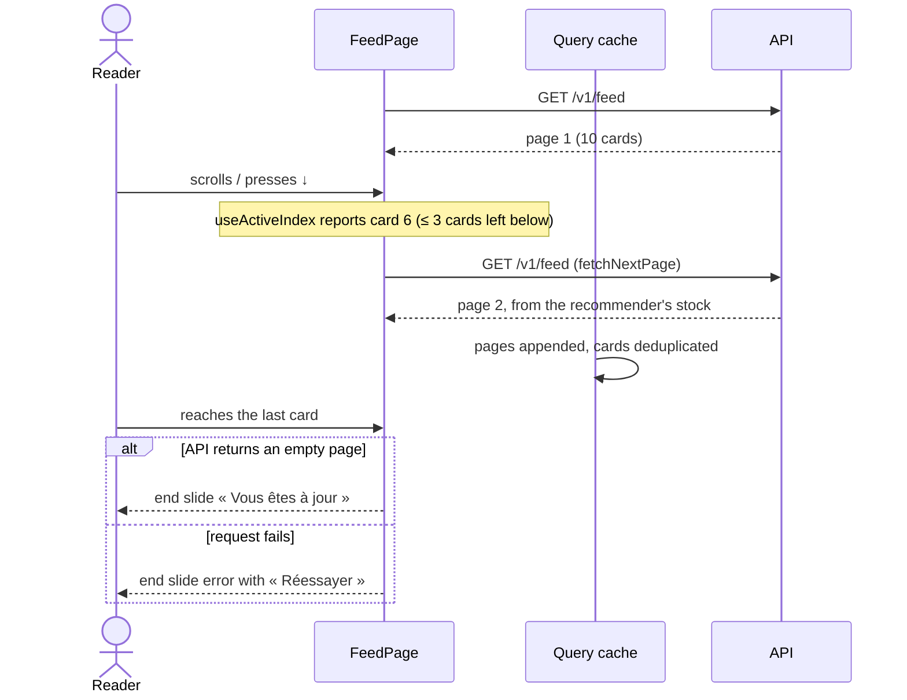
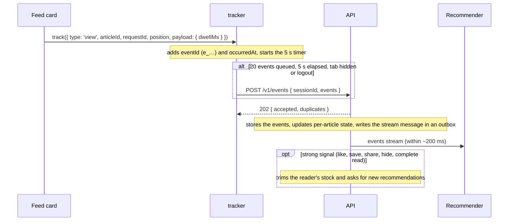
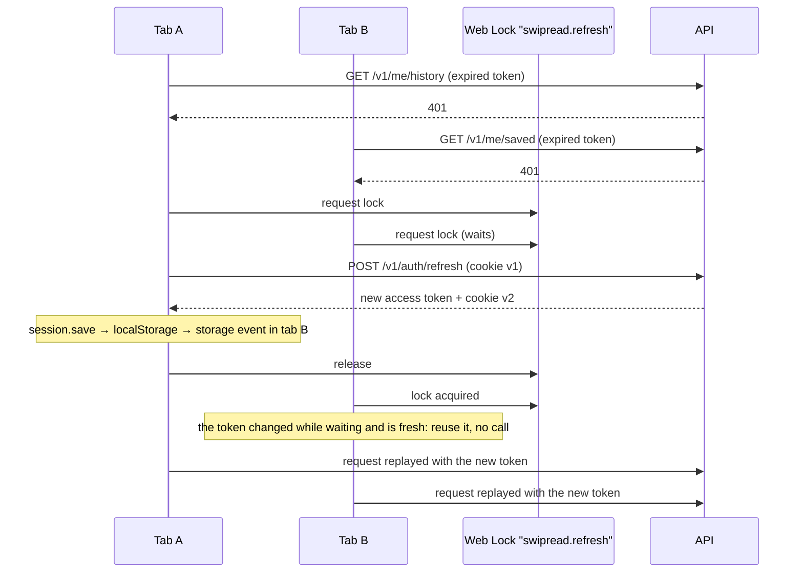
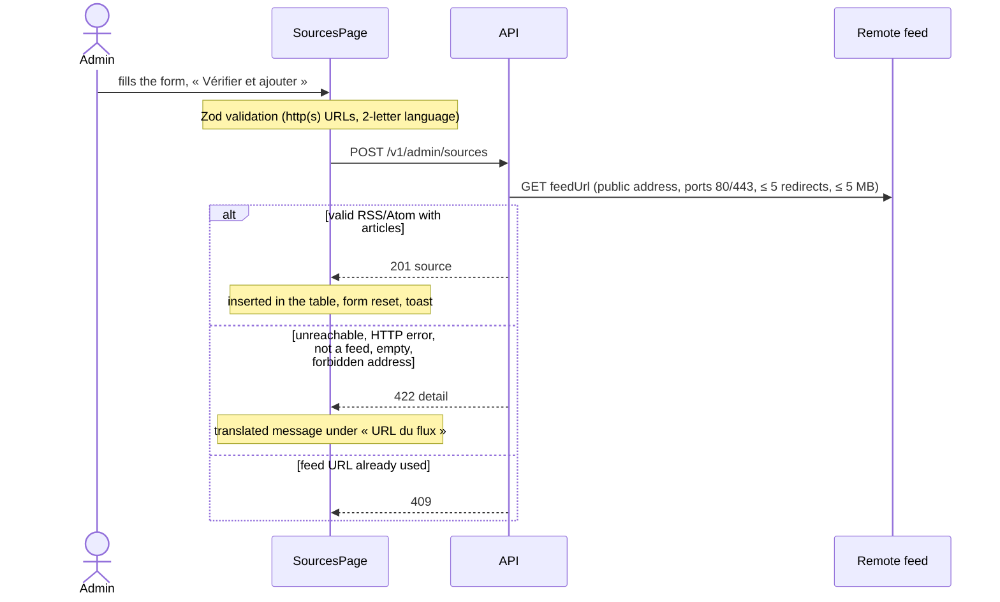

# Flows

Step-by-step sequences for the paths that cross several modules. Participants: the React screens (UI), the typed client (`api`), the event queue (`tracker`) and the API.

## First visit: sign-up → onboarding → feed



## Feed paging



Each call consumes articles on the server, which is why the feed is never refetched and why changing topics drops it from the cache.

## Life of an event



On a network error, 429 or 5xx the batch goes back to the head of the queue and is sent again later; the API ignores duplicates by `eventId`. On `pagehide` the queue closes the current `view` and sends everything with `keepalive`.

## Open and read an article

```mermaid
sequenceDiagram
    actor R as Reader
    participant F as Feed
    participant T as tracker

    R->>F: « Lire l'article »
    F->>T: open
    Note over F: the source's page opens in a new tab; the app tab becomes hidden
    Note over F: dwell of the current card paused
    R->>F: comes back to the app tab
    F->>T: read { readMs: time away }
    Note over F: dwell resumes for the current card
```

## Token renewal across tabs



If two renewals still reach the API with the same cookie (no Web Locks support, separate browser windows racing), the second one arrives within the API's 10-second grace period and gets an access token without rotation. A refresh token reused after that period is treated as stolen: the API revokes the whole session and both tabs end up on the login page.

## Add a source (admin)



## Remove a saved article

```mermaid
sequenceDiagram
    actor R as Reader
    participant S as SavedPage
    participant Q as Query cache
    participant T as tracker
    participant A as API

    R->>S: « Retirer »
    S->>T: unsave { articleId }
    S->>Q: remove from ['saved'], saved=false in ['feed']
    S-->>R: toast, focus on the next row
    T->>A: POST /v1/events (within 5 s)
    Note over A: saved_at cleared; the next GET /v1/me/saved no longer lists it
```
